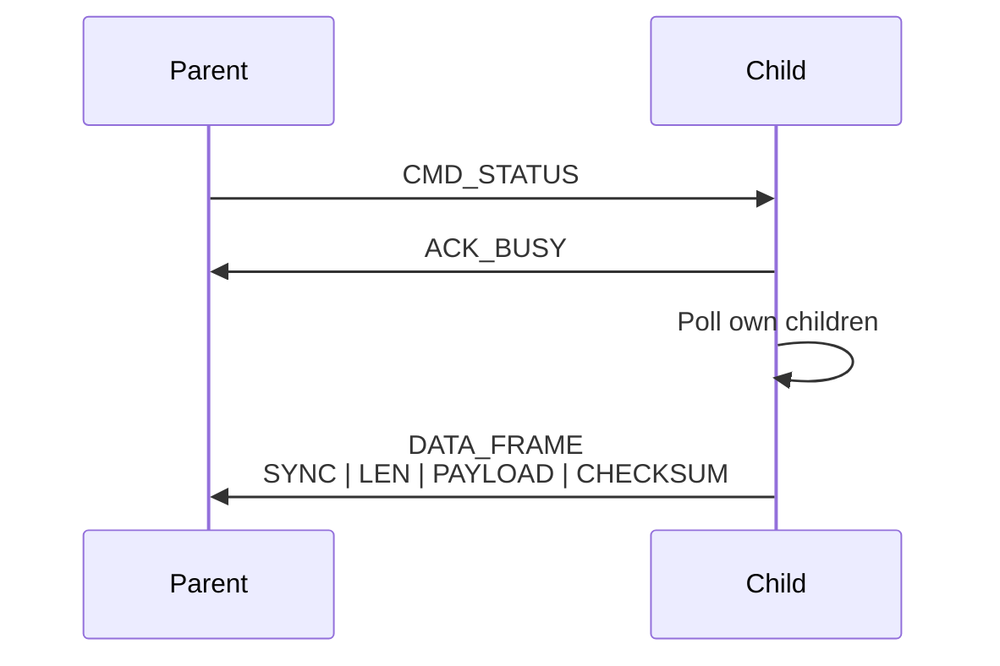

# Communication Protocol
erklärung nachrichtenprotokoll
Also:
- Wie sieht ein Byte aus?
- Welche Befehle gibt es?
- Wie sieht ein Frame aus?
- Wie sieht der Payload aus?
- Wie wird der Baum serialisiert?
- Wie erkennt man Fehler?

- beschreibung datenmodell (Data Frame, serialized ary?), 
## datenmodell
Welche Informationen gibt es? node_id, orientation, child_mask, children
## Nachrichtenprotokoll/Kommunikationsprotokoll
Wie wird die Bytefolge übertragen? CMD_STATUS, ACK_BUSY, SYNC, LEN, PAYLOAD, CHECKSUM
***generell***
im protokoll ist geregelt:
- Syntax: Das Format und die Struktur der Daten (z. B. wie die Nachricht in Bits und Bytes zerlegt wird).
- Semantik: Die Bedeutung der einzelnen Steuerungsinformationen (z. B. Befehle zur Fehlerkorrektur oder Verbindungsbestätigung)
- Synchronisation: Den Ablauf und das Timing der Übertragung (z. B. wer wann sendet oder ob es sich um eine bidirektionale Kommunikation handelt).

physikalische ebene: single wire half duplex leitung technisch umgesetzt als open drain ähnliches verhalten
byte übertragung: bit banged (ähnlich wie uart)
befehlsprotokoll zwischen parent und child: kommunikation immer vom parent zum child
frame protokoll: data frame
payload protokoll: baum als preorder &rarr; Payload beschreibt den Würfelbaum rekursiv in Preorder-DFS.

- Kommunikation (Nachrichtenaufbau Nachrichtenprotokoll - wie wird die Bytefolge übertragen? CMD_STATUS, ACK_BUSY, SYNC, LEN, PAYLOAD, CHECKSUM),
### command bytes
### frame structure -generell
### payload structure -generell
### frame und payload diagramm -generell
DATA FRAME
┌──────┬─────┬──────────────────────────────┬──────────┐
│ SYNC │ LEN │           PAYLOAD            │ CHECKSUM │
└──────┴─────┴──────────────────────────────┴──────────┘

PAYLOAD
┌─────────┬─────────────┬────────────┬────────────────┐
│ NODE_ID │ ORIENTATION │ CHILD_MASK │ CHILD_PAYLOADS │
└─────────┴─────────────┴────────────┴────────────────┘
### timing diagramm- generell
Parent line:  ──────┐ CMD_STATUS ┌──────────── wait ───────────
                    └────────────┘

Child line:   ───────────── wait ───── ACK_BUSY ─── DATA_FRAME ──

Time:         t0             t1        t2          t3

&rarr; in the making
### Kommunikationssequenz Diagramm -wichtig

---
- elektrische Funktionsweise One Wire Bus

-  bedeutung von Child mask
-  Recursive payload aggregation
&rarr; baum zu payload diagramm
Tree:

A1
├── B2
│   └── D4
└── C3

Preorder payload:

A1 00 03 | B2 01 01 | D4 03 00 | C3 02 00
---
## Payload Serialization and Deserialization
erklären Datenmodell und die Serialisierung/Deserialisierung
Payload-Struktur
Preorder-Prinzip
Warum Child-Mask nötig ist
Wie der Parser weiß, wann ein Node Kinder hat
Wie rekursiv weitergelesen wird
---
-  Deserialization principle
-  Optional external WLAN communication

