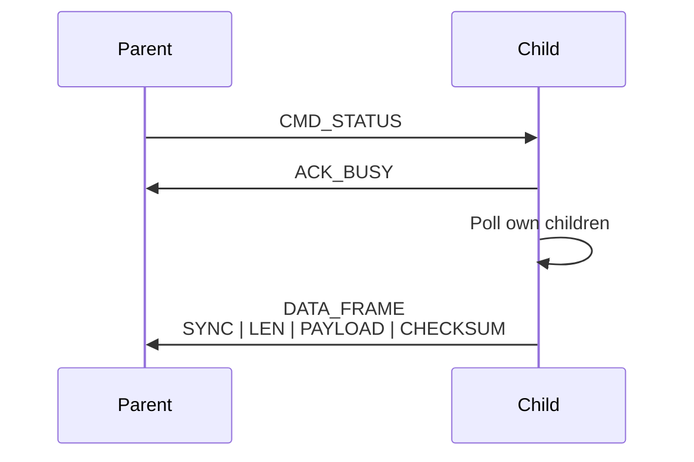

# Communication Protocol
paper: custom uart one wire 

## Physical Communication Principle
bereits in hardware.md enthalten??
The physical communication uses a single-wire half-duplex connection.

The idle state of the line is high.

```text
idle   = HIGH
active = LOW
```

A device transmits by either pulling the line low or releasing it. The line is not actively driven high &rarr; open drain like behavior.

Data transmission is implemented in software using a UART-like bit timing scheme.

### Byte Format

Each byte is transmitted using a software UART-like format:

START | DATA[7:0] | STOP

where:
- START = logic 0
- DATA = 8 data bits (least significant bit first)
- STOP = logic 1

## 4. Command bytes

The protocol uses fixed command bytes for the start of the communication between two cubes (anfrage ist jemand da und antwort ja ich bin da)

| Name | Value | Meaning |
|---|---:|---|
| `CMD_STATUS` | `0xAA` | Parent requests data from child |
| `ACK_BUSY` | `0x55` | Child acknowledges command and prepares response |

---

## Data Frame Structure/Format

The data frame contains a complete serialized payload (von cube und all seinen children).

```text
SYNC | LEN | PAYLOAD | CHECKSUM
```

| Field | Size | Description |
|---|---:|---|
| `SYNC` | 1 byte | Frame start marker |
| `LEN` | 1 byte | Number of payload bytes |
| `PAYLOAD` | n bytes | Serialized cube tree |
| `CHECKSUM` | 1 byte | XOR checksum over payload |


## 8. Payload Data Model/Format

The payload represents a serialized n-ary tree. (Payload beschreibt den Würfelbaum rekursiv in Preorder-DFS)

Each cube is represented as one node. Each node consists of three header bytes:

```text
NODE_ID | ORIENTATION | CHILD_MASK
```

After these three bytes, the payloads of all connected children follow recursively.

General node structure:

```text
NODE = NODE_ID | ORIENTATION | CHILD_MASK | CHILD_PAYLOAD_SUBTREES
```

| Field | Size | Description |
|---|---:|---|
| `NODE_ID` | 1 byte | Unique identifier of the cube |
| `ORIENTATION` | 1 byte | Orientation relative to the parent |
| `CHILD_MASK` | 1 byte | Bit mask of connected child ports (genauer erklären?)|
| `CHILD_PAYLOADS` | variable | Serialized payloads of connected children |

**Creating the payload**
The parent cube does not store the complete frame inside its own payload. It only stores the child payload.

Received child frame:

```text
SYNC | LEN | CHILD_PAYLOAD | CHECKSUM
```

Stored inside parent payload:

```text
CHILD_PAYLOAD
```

The parent cube then builds its own payload:

```text
OWN_NODE_ID | OWN_ORIENTATION | OWN_CHILD_MASK | CHILD_0_PAYLOAD | CHILD_1_PAYLOAD | ...
```

Finally, the cube sends this combined payload upstream as a new complete frame:

```text
SYNC | TOTAL_LEN | TOTAL_PAYLOAD | CHECKSUM
```
---

## Communication Protocoll/Nachrichtenprotokoll
Wie wird die Bytefolge übertragen? CMD_STATUS, ACK_BUSY, SYNC, LEN, PAYLOAD, CHECKSUM

Communication follows a request-response model.

A parent module initiates communication by transmitting a status request to one of its child ports. A connected child acknowledges the request and subsequently returns its complete data frame.

The communication sequence between two directly connected modules is:

Parent                Child

CMD_STATUS      →
                ← ACK_BUSY

                ← DATA_FRAME

The child does not immediately transmit its own information. Instead, it first collects information from all connected child modules, combines the received data with its own local information and finally transmits a single aggregated frame to its parent.

This recursive aggregation mechanism allows the complete tree structure to be reconstructed at the baseplate.


### Kommunikationssequenz Diagramm -wichtig
&rarr; in the making



### timing diagramm- generell
Parent line:  ──────┐ CMD_STATUS ┌──────────── wait ───────────
                    └────────────┘

Child line:   ───────────── wait ───── ACK_BUSY ─── DATA_FRAME ──

Time:         t0             t1        t2          t3


---


## Payload/tree Serialization and Deserialization
bla bla bla
---
-  Deserialization principle
-  Optional external WLAN communication

---
##archiv
erklärung nachrichtenprotokoll
Also:
- Wie sieht ein Byte aus?
- Welche Befehle gibt es?
- Wie sieht ein Frame aus?
- Wie sieht der Payload aus?
- Wie wird der Baum serialisiert?
- Wie erkennt man Fehler?


- beschreibung datenmodell (Data Frame, serialized ary?), 
## datenmodell
Welche Informationen gibt es? node_id, orientation, child_mask, children
## Nachrichtenprotokoll/Kommunikationsprotokoll
Wie wird die Bytefolge übertragen? CMD_STATUS, ACK_BUSY, SYNC, LEN, PAYLOAD, CHECKSUM
***generell***
im protokoll ist geregelt:
- Syntax: Das Format und die Struktur der Daten (z. B. wie die Nachricht in Bits und Bytes zerlegt wird).
- Semantik: Die Bedeutung der einzelnen Steuerungsinformationen (z. B. Befehle zur Fehlerkorrektur oder Verbindungsbestätigung)
- Synchronisation: Den Ablauf und das Timing der Übertragung (z. B. wer wann sendet oder ob es sich um eine bidirektionale Kommunikation handelt).

physikalische ebene: single wire half duplex leitung technisch umgesetzt als open drain ähnliches verhalten
byte übertragung: bit banged (ähnlich wie uart)
befehlsprotokoll zwischen parent und child: kommunikation immer vom parent zum child
frame protokoll: data frame
payload protokoll: baum als preorder &rarr; Payload beschreibt den Würfelbaum rekursiv in Preorder-DFS.