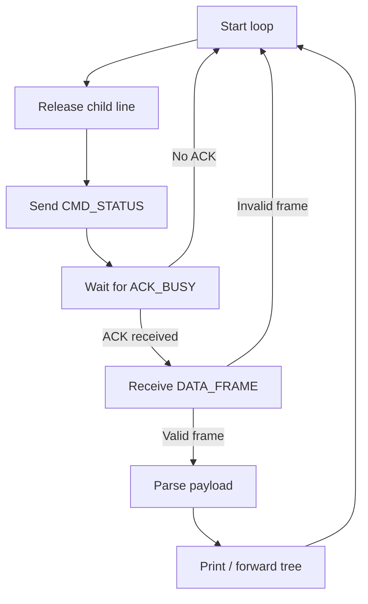
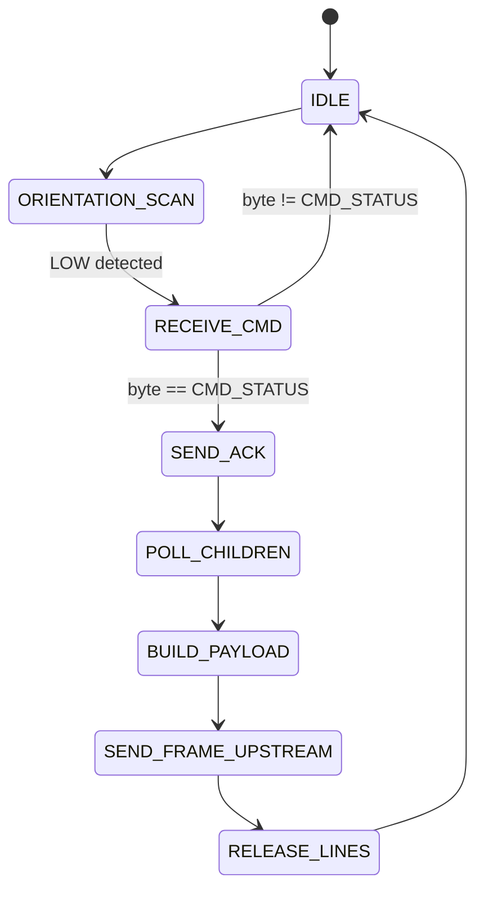

#content
Ablaufdiagramm und Struktur der Software von baseplate

---
## generell
### child polling
### vlt auch main loop und frame reception

## baseplate
was macht die basplate im code?
###  role
The baseplate is the root of the system. It starts the communication and receives the complete serialized cube tree.

### main loop
1. Release all lines.
2. Send CMD_STATUS to child.
3. Wait for ACK_BUSY.
4. Receive DATA_FRAME.
5. Validate frame.
6. Parse payload.
7. Output tree.
### baseplate flowchart -optional

### (frame reception and) payload parsing

### error behavior??

### pseudocode
void loop()
{
    send_status_command(child_0);

    if (!receive_ack_busy(child_0)) {
        return;
    }

    if (!receive_frame(child_0, payload, MAX_PAYLOAD_LEN, &payload_len)) {
        return;
    }

    parse_payload_to_tree(payload, payload_len, &root_index);
}
### payload parsing
nicht die Theorie, sondern wann die Baseplate den Parser benutzt.

After the baseplate receives and validates a complete data frame, it passes only the payload to the tree parser. The parser reconstructs the n-ary tree recursively.
---
## cube
### role
Each cube acts as a child toward its parent and as a parent toward its own children.

### state machine diagram

### main loop

### pseudo code

