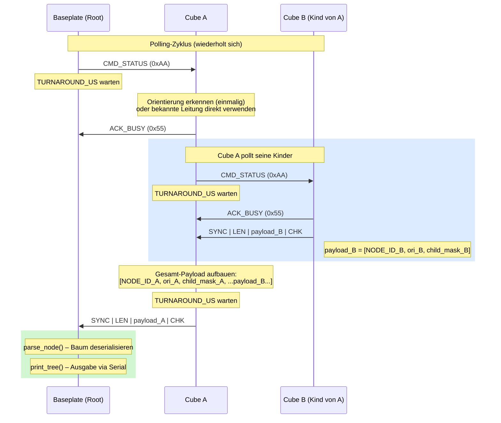
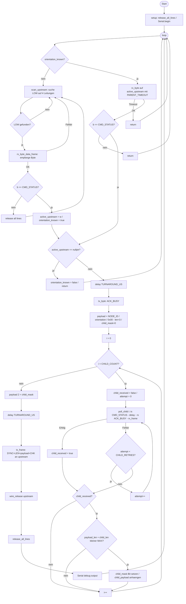
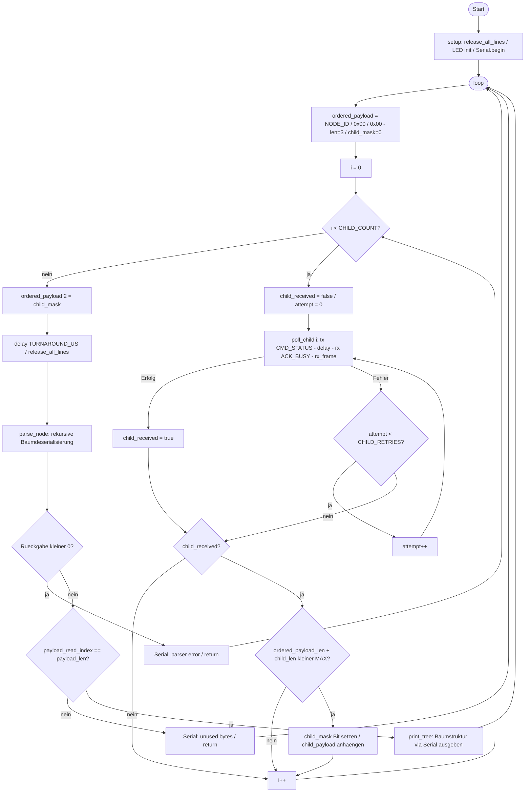
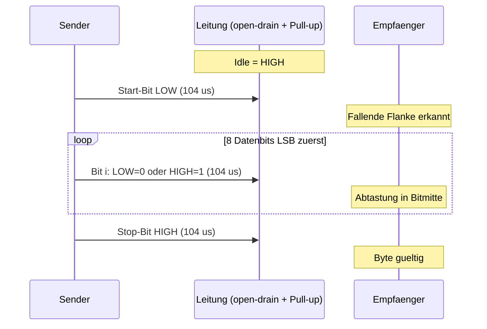

# Elena Cubes – Programmablauf

Zum Rendern in VS Code: Datei öffnen → `Ctrl+Shift+V`.  
Empfohlene Extension: **Mermaid Chart** (von Mermaid Chart, Inc. – offizielle Extension).

---

## 1. Kommunikationsprotokoll



---

## 2. Frame-Format

```
SYNC (0xA5) | LEN (1B) | PAYLOAD (LEN Bytes) | CHK (1B)

CHK = XOR(LEN, payload[0], ..., payload[LEN-1])

Payload-Struktur (preorder-serialisierter Baum):
  [NODE_ID] [orientation] [child_mask] [payload Kind 0] [payload Kind 1] ...
   1 Byte     1 Byte        1 Byte       rekursiv

  child_mask: Bit i = 1 --> Kind an Port i vorhanden
```

---

## 3. Cube-Firmware – Hauptschleife



---

## 4. Baseplate-Firmware – Hauptschleife



---

## 5. Wire-Bus – Byte-Uebertragung

