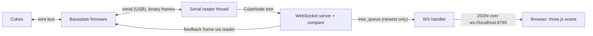
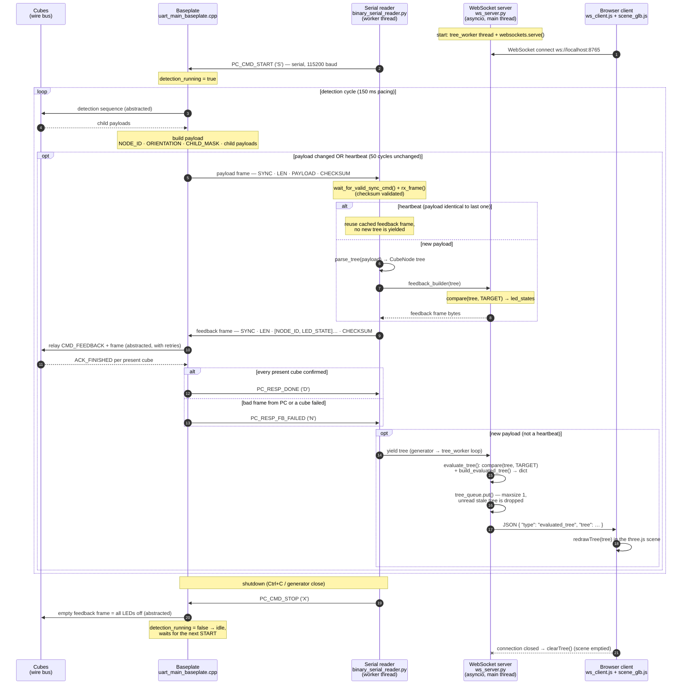

# Sequence: Baseplate ↔ PC ↔ Visualization

Communication flow of the PC-controlled building sequence, from the baseplate
firmware over the serial link to the Python backend and on to the three.js
frontend. The detection and feedback exchanges on the wire bus between
baseplate and cubes are **abstracted** (single arrows) — this diagram focuses
on the serial protocol and the server/client side.

Source files:

- Firmware: `src/firmware_baseplate/uart_main_baseplate.cpp`
- Serial reader: `tools/threejs_visualization/backend/binary_serial_reader.py`
- WebSocket server: `tools/threejs_visualization/backend/ws_server.py`
- Frontend: `tools/threejs_visualization/frontend/src/ws_client.js`, `main.js`, `scene_glb.js`

## Pipeline overview

## Sequence diagram

## Error handling on the serial link

| Situation | Detected by | Reaction |
|---|---|---|
| Broken payload frame from baseplate (timeout mid-frame, checksum mismatch) | Serial reader (`rx_frame`) | Input buffer flushed, byte-by-byte re-sync on the next SYNC; **no reply sent** — the firmware's `PC_REPLY_TIMEOUT_MS` covers it and the cycle continues |
| Payload does not parse into a valid tree | Serial reader (`parse_tree` raises `ValueError`) | Frame dropped, buffer flushed, no feedback frame — firmware timeout covers it |
| Broken feedback frame from PC (wrong SYNC, bad length/checksum, byte gap) | Firmware (`read_pc_reply` → `PC_REPLY_BAD`) | Stray bytes drained, `PC_RESP_FB_FAILED` sent, next cycle continues |
| No reply from PC at all | Firmware (`PC_REPLY_TIMEOUT`) | Nothing sent, next detection cycle continues |
| A cube does not confirm the relayed feedback after all retries | Firmware (`relay_feedback_to_children`) | `PC_RESP_FB_FAILED` sent to the PC (reported, not fatal) |
| Status byte from baseplate missing or `FB_FAILED` | Serial reader (`send_feedback_frame`) | Logged only, never fatal — the stream continues |

Two details worth remembering when reading the diagram:

- **Every valid payload frame must be answered** (heartbeats included) — the
  firmware blocks for up to `PC_REPLY_TIMEOUT_MS` waiting for the feedback
  frame, so a silent PC would stall each frame for that timeout.
- `compare()` runs **twice per tree** (once for the feedback frame in the
  reader thread, once in `evaluate_tree` for the frontend dict); trees are
  small, so recomputing is simpler than sharing the result across the
  thread boundary.
