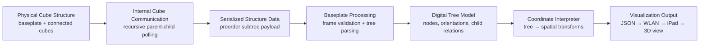

# System Overview
## ToDos
- Überschriften
- System architektur diagram
- Data Flow Diagram
- alles was nach der datensammlung passiert - visualisierung, verbindung zu ipad etc
---

## System Purpose
The system consists of a baseplate and multiple cube modules. The goal is to detect the physical arrangement of the connected cubes and reconstruct this arrangement as a digital tree structure.
Each cube can detect its parent connection and its own connected children. The baseplate initiates the communication and receives the complete serialized structure from the first connected cube.
The resulting data will then be used for creating an digital twin of the construction as a visual representation (for educational games)

---

## Main components
- Cube modules
- Baseplate
- optional gateway (interface between two systems)/controller for visualization &rarr; in progress
- device for vizualization &rarr; in progress

## Basic System Architecture
The physical cube structure is interpreted as a hierarchical tree, whereas the baseplate is the root of the tree and each cube is represented as one node in the tree.

```text
Baseplate
└── Cube
    ├── Cube
    │   └── Cube
    └── Cube
```
---

## Functional Principle
### Parent - Child behavior??
**Cube**:

Each cube module has n sides. 1 upstream side/face and n-1 downstream sides/face (vlt doch parent/child face nennen)
- `Upstream side/face`: It´s used by the cube to connect to another module &rarr; forms the cube’s upstream connection to its parent cube or to the baseplate.
- `Downstream side/face`: It´s used by other cubes to connect with this side &rarr; forms the downstream connection from the current cube to its own child module. 

This results in the following structure:
- each cube has one parent connection
- each cube can have up to n-1 child connections
- the complete system forms a directed tree structure (with cubes as nodes)


**Term Explanation?**
| Term                             | Definition                                                                |
| --------------------------------------------- | ------------------------------------------------------------------------ |
| `Upstream side/face`              | side with which the current cube docks to its parent cube or to the baseplate                |
| `Downstream side/face` | side where other cubes can dock as child modules                      |
| `Parent cube`                                 | module above the current cube in the hierarchy (,or the baseplate)             |
| `Child cube`                                  | cube connected to one of the downstream sides of the current cube |


**Baseplate**:

acts nur als parent 

### System Structure?
The System is structured as a parent-child hierarchy inlcuding one baseplate and n? cubes and follows a simple transaction pattern: 
The Baseplate forms the root of the hierarchy and initiates the detection process by polling the first connected cube module. 
The child cube responds to indicate its presence and then determines its orientation based on the upstream pin on which the command was received. Afterwards, the child module temporarily takes on the role of the parent for its own connected children, polls them and collects their structural data. When this is done, it combines this information with its own node data and sends a description of its complete subtree back to its parent.

This process is repeated recursively until the baseplate receives a complete description of the entire physical cube structure from its first polled child.

---

## Data Flow
The data flow starts at the baseplate which initiates the detection process in the connected cube network. The cube network then recursively collects the structure of all connected modules and sends the complete structural description back to the baseplate. Afterwards, the received data is converted into an internal tree representation. 
??? needs to be IMPROVED
```text
Baseplate
    ↓
Cube network
    ↓
Baseplate
    ↓
Tree representation
    ↓
Coordinate interpretation
    ↓
Visualization data
    ↓
3D visualization
```
---

## (Final target Architecture)
### Systemarchitecture Diagramm
= Modell, das die Ansichten, die Struktur und das Verhalten des Systems konzeptionell definiert &rarr; Darstellung und Beschreibung, wie das System im Allgemeinen funktioniert und mit anderen Systemkomponenten kommuniziert. 

??? needs to be IMPROVED

---
# Archiv

### cube sides
( 1 child site und n-1 parent sites.
child site: mit dieser seite kann sich baustein an andere bausteine andocken. er erzeugt die upstream connection to its parent cube or the baseplate
parent sites: an diesen seiten können andere bausteine sich verbinden. bildet die downstream connections to its own child cube modules )

Therefore, each cube has exactly one possible upstream connection to a parent cube and up to n-1 possible downstream connections to child cubes.

### data flow
Baseplate -> Cubes/Cube Network -> Baseplate -> Tree Parser?? -> Coordinate Interpreter -> JSON -> Vizualization


```text
Baseplate
    └── sends CMD_STATUS
        └── Cube receives command
            └── Cube sends ACK_BUSY
                └── Cube polls own children
                    └── Cube receives child frames
                        └── Cube builds own payload
                            └── Cube sends frame upstream
                                └── Baseplate receives frame
                                    └── Baseplate parses payload
```
### system architecture diagramm
chatgpt generated

```mermaid
flowchart LR

    %% ======================================================
    %% Physical cube structure
    %% ======================================================

    subgraph PHYSICAL["Physical Cube Structure"]
        BP["Baseplate<br/>(root of structure)"]

        C1["Cube Node<br/>parent: Baseplate<br/>children: Cube 2, Cube 3"]
        C2["Cube Node<br/>parent: Cube 1<br/>children: Cube 4"]
        C1["Cube Node<br/>parent: Cube 1<br/>children: none"]
        C2["Cube Node<br/>parent: Cube 2<br/>children: none"]

        BP -->|"polls downstream"| C1
        C1 -->|"polls downstream"| C2
        C1 -->|"polls downstream"| C1
        C2 -->|"polls downstream"| C2
    end

    %% ======================================================
    %% Internal communication
    %% ======================================================

    subgraph INTERNAL["Internal Cube Communication"]
        WIRE["Single-wire half-duplex links<br/>open-drain-like behavior<br/>HIGH = idle, LOW = active"]
        PROTOCOL["Custom cube protocol<br/>poll request, acknowledgement,<br/>data frame"]
        PAYLOAD["Serialized subtree payload<br/>NODE_ID | ORIENTATION | CHILD_MASK | CHILD_PAYLOADS"]
    end

    PHYSICAL --> WIRE
    WIRE --> PROTOCOL
    PROTOCOL --> PAYLOAD

    %% ======================================================
    %% Baseplate data processing
    %% ======================================================

    subgraph BASEPLATE_PROCESSING["Baseplate Data Processing"]
        FRAME_RX["Receive complete data frame<br/>from first cube"]
        VALIDATE["Validate received frame<br/>length + checksum"]
        PARSER["Tree parser<br/>recursive deserialization<br/>of preorder payload"]
        TREE["Internal tree model<br/>nodes + children + orientations"]
    end

    PAYLOAD --> FRAME_RX
    FRAME_RX --> VALIDATE
    VALIDATE --> PARSER
    PARSER --> TREE

    %% ======================================================
    %% Interpretation and visualization
    %% ======================================================

    subgraph INTERPRETATION["Geometry and Visualization Pipeline"]
        COORDS["Coordinate / orientation interpreter<br/>tree → spatial transforms"]
        JSON["Visualization data format<br/>JSON structure"]
        WIFI["External communication<br/>WLAN / HTTP / WebSocket"]
        IPAD["iPad / browser"]
        VIS["3D visualization<br/>Three.js or MeshCat"]
    end

    TREE --> COORDS
    COORDS --> JSON
    JSON --> WIFI
    WIFI --> IPAD
    IPAD --> VIS
```


