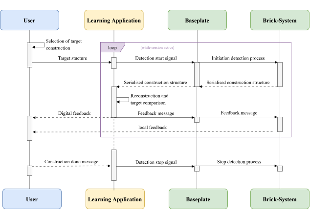

# System Architecture

>final
## Overview
The developed system combines active smart bricks, a baseplate, a Python based backend and a browser-based frontend in a physical in a closed
physical-digital interaction loop.  
A construction task starts when a target structure is selected in the
in the learning application. Once the activity is started, the
application triggers the detection process through the baseplate which then initiates cyclic detection of the connected brick structure. 
The detected construction is transferred to the backend, reconstructed digitally and compared with the selected target. Based on this comparison, feedback is provided in the frontend and directly on the bricks.

### Connection Possibilities
The bricks can be connected through different faces and can additionally be rotated relative to each other. This enables linear, angled and branching three-dimensional constructions.
The physical detection of the relative orientation is described in the [Hardware](hardware.md#orientation-detection) documentation.

For the communication between the electronic components, see [Communication Protocol](docs/communication-protocol.md).

## System Components
| Component | Responsibility |
|:---|:---|
| Building bricks | Form the physical construction, provide local connection information and local feedback |
| Baseplate | Forms the root of the construction, supplies power and connects the brick system to the host computer |
| Backend | Reconstructs and evaluates the detected construction and generates feedback |
| Frontend | Provides target selection, 3D visualisation and user-facing feedback |

## Construction Model
The physical construction is represented as a directed tree with the baseplate as the root. Each connected building brick forms one node and each physical connection represents a parent-child relationship. A brick is connected to its parent through its single upstream interface/connection and, depending on the brick type, provides one or more downstream interfaces/connections for child bricks.

Each node contains the information required to reconstruct the structure:

- brick identity and type,
- orientation relative to its parent,
- occupied receiving interfaces,
- subordinate child nodes.

This allows the overall structure to be reconstructed only through local cube-to-cube connections. Global positions and orientations are calculated later in the learning application. 

Communication follows the same parent-child hierarchy. Starting from the baseplate, each brick recursively queries its connected children and combines their information with its own node data. The resulting subtree representations are returned towards the baseplate until the complete physical construction has been collected and transmitted to the ?backend/frontend? learning application.

Details of the recursive communication and transmitted data are provided in the [Communication Protocol](docs/communication_protocol.md).

## Data Flow
The interaction between the learner, learning application, baseplate and brick system is shown below.

During each detection cycle, the baseplate initiates the acquisition of the physical construction. Starting from the root brick, the connected structure is collected recursively through the parent-child hierarchy and returned to the learning application.

The application reconstructs the detected structure and compares it with the selected target. Based on the comparison, digital feedback is displayed to the learner and brick-specific feedback is sent back through the baseplate and forwarded through the connected brick structure. The cycle is repeated while the construction session is active.

## Software Architecture
The learning application consists of a Python backend and a browser-based
JavaScript frontend.  
The backend communicates with the baseplate through a serial connection and with the frontend through a WebSocket connection.

The backend is responsible for:
- deserialising the detected construction
- reconstructing the tree representation
- comparing it with the selected target
- generating feedback

The frontend is responsible for:
- target selection
- 3D visualisation
- spatial placement of the digital brick models
- presentation of digital feedback and construction progress

## Separation of Detection and Evaluation
The physical brick system detects the construction independently of the selected learning task.

The bricks and baseplate determine:

> What is physically connected?

The backend determines:

> How does this construction compare with the selected target?

This separates physical topology acquisition from task-specific evaluation and allows the same detection system to be used with different construction tasks.

