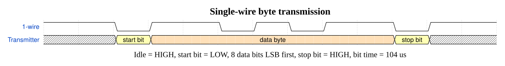
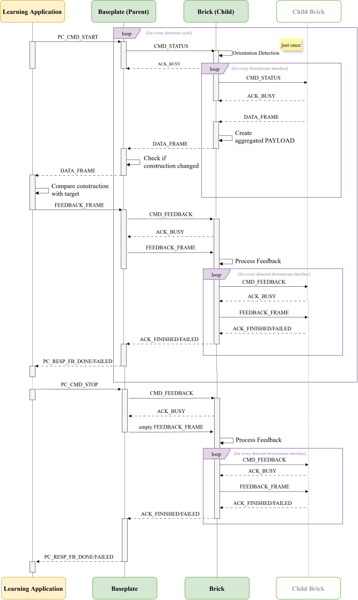

>final 

# Communication Protocol
## Overview
The system uses two communication interfaces:

- a software-controlled single-wire half-duplex connection between the baseplate and the building bricks as well as between neighbouring bricks
- a hardware USART connection between the baseplate and the host computer

The messages for the construction detection and feedback data use a common binary frame format explained later in this document. Different commands and payload structures distinguish the individual communication processes.

For the overall system structure and data flow, see [System Architecture](docs/architecture.md).

## Communication Interfaces
| Communication Interface | Physical Implementation | Transmission Rate |
|:---|:---|:---|
| Learning application ↔ baseplate| Hardware USART through a USB-to-TTL UART adapter | 115200 bit/s |
| Baseplate ↔ brick / brick ↔ brick| Software-controlled single-wire half-duplex connection | approximately 9.6 kbit/s |

## Single-Wire Communication
Communication between two directly connected modules is implemented as a bidirectional single-wire half-duplex interface. The same data line is used alternately by the parent and child brick and only one participant may transmit at a time.  
The idle state of the line is logic HIGH. A transmitter either pulls the line LOW or releases it and uses the internal pull-up resistor.

Each byte uses a UART-like format:

The implemented bit duration is `104 µs`, corresponding to approximately 9.`6 kbit/s`. A turnaround delay of `312 µs` is used when the transmission direction changes.

## Parent Child Communication
The communication within the physical construction follows a request–response procedure and is always initiated by the parent brick.  
Depending on the current process, the communication is used either to retrieve the detected construction or to transmit feedback towards the connected bricks. The command and acknowledgement bytes used in the two processes are: 

| Message | Value | Direction | Meaning |
|---|---:|---|---|
| `CMD_STATUS` | `0xAA` | Parent → Child | Request detected subtree |
| `ACK_BUSY` | `0x55` | Child → Parent | Request received and being processed |
| `CMD_FEEDBACK` | `0xCC` | Parent → Child | Announce feedback frame |
| `ACK_FINISHED` | `0x66` | Child → Parent | Feedback successfully processed and forwarded |
| `ACK_FAILED` | `0x77` | Child → Parent | Feedback invalid or forwarding failed |

## Common Frame Format
Construction and feedback data forwarded from brick to brick are encapsulated in a variable-length binary frame:

| Field | Size | Description |
|:---|:---|:---|
| `SYNC`| 1 byte | Beginning of frame |
| `LEN` | 1 byte | Number of payload bytes | 
| `PAYLOAD` | 0-128 bytes | Message specific data |
| `CHECKSUM` | 1 byte | XOR checksum

The payload stored in the `PAYLOAD` field contains the information transmitted by the frame. Its structure depends on whether it contains the detected tree structure or the feedback message.

The checksum is calculated from the length field and all payload bytes.

## ID Explanation
Each non-baseplate brick identifies itself with an 8-bit `NODE_ID`, built at compile time from its cube type and its per-type instance number (see [cube_identity.h](../firmware/include/cube_identity.h)):
- Bits 7..5 (`CUBE_TYPE`): identifies the brick type; used to compare the detected construction against the target tree.
- Bits 4..0 (instance, masked with `INSTANCE_MASK = 0x1F`): distinguishes multiple bricks of the same type, up to 31 instances per type.

`CUBE_TYPE` and the instance number are not set directly, but derived from PlatformIO build flags per firmware environment (e.g. `-DCUBE_TYPE_NORMAL -DCUBE_INSTANCE=1`, see `platformio.ini`).

**Cube type codes**:

| Brick Type | `CUBE_TYPE` | Notes |
|---|---|---|
| Normal (cube brick) | `0x00` |
| Smashed brick | `0x01` |
| Baseplate | — |

## Construction Detection 
To retrieve the detected subtree of a connected child, the parent sends `CMD_STATUS`. The child responds with `ACK_BUSY` and subsequently queries its own downstream interfaces. After all subordinate information has been collected, the child returns a `DATA_FRAME` containing its own node information and the serialised representations of its child subtrees.

This process is applied recursively throughout the connected brick structure till the baseplate.

### Detection Payload
The payload (data) returned during this sequence represents the detected construction tree. Each brick contributes a three-byte node header, followed by the serialised representations of its subordinate bricks:

| Field | Size | Description |
|---|---:|---|
| `NODE_ID` | 1 byte | Brick type and individual instance |
| `ORIENTATION` | 1 byte | Relative orientation to the parent |
| `CHILD_MASK` | 1 byte | Occupied downstream interfaces |
| `CHILD_NODE_PAYLOAD` | variable | Serialised child subtrees |

Received child frames are not embedded as complete frames within the parent payload. Instead, only their payloads are appended in the predefined interface order to the parent’s own node information.

## Feedback Communication
The feedback communication is also initiated by the parent node, but with another command message: Feedback transmission is initiated using `CMD_FEEDBACK`. The child responds with `ACK_BUSY`, receives the `FEEDBACK_FRAME`, processes its own feedback state and forwards the frame to its detected children.

### Feedback Payload
The feedback payload (data) uses the common frame format but contains pairs of brick identifiers and LED states:

| Field | Size | Description |
|---|---:|---|
| `NODE_ID` | 1 byte | Identifier of the addressed brick |
| `LED_STATE` | 1 byte | Local feedback state |

If a brick's `NODE_ID` is not included in the feedback payload, its local LED output is switched off. An empty feedback payload is
therefore used at the end of a construction task to deactivate all local feedback simultaneously.

## Learning Application Baseplate Communication
Communication between the Python backend and the baseplate uses hardware USART through a USB-to-TTL UART adapter.

Serial configuration:
- 115200 bit/s
- 8 data bits
- no parity
- 1 stop bit

The learning application controls an interaction session using the following single-byte commands and responses: 

| Message | Value | Direction | Meaning |
|---|---:|---|---|
| `PC_CMD_START` | `0x53` (`S`) | Application → Baseplate | Start cyclic detection |
| `DATA_FRAME` | variable | Baseplate → Application | Current serialised construction |
| `FEEDBACK_FRAME` | variable | Application → Baseplate | Brick-specific feedback |
| `PC_RESP_FB_DONE` | `0x44` (`D`) | Baseplate → Application | Feedback successfully forwarded |
| `PC_RESP_FB_FAILED` | `0x4E` (`N`) | Baseplate → Application | Feedback invalid or forwarding failed, PC feedback communication invalid |
| `PC_CMD_STOP` | `0x58` (`X`) | Application → Baseplate | Stop detection and clear feedback |

A session begins with `PC_CMD_START` of the learning application. The baseplate then detects the construction and transmits a `DATA_FRAME`.

After evaluating the construction, the application returns a `FEEDBACK_FRAME`. The baseplate forwards this frame to the connected bricks and reports the result using `PC_RESP_FB_DONE` or `PC_RESP_FB_FAILED`.

`PC_CMD_STOP` terminates cyclic detection and causes an empty feedback frame to be forwarded so that all brick LEDs are switched off.

Communication sequence between the learning application backend, baseplate and connected bricks

## Error Handling and Validation

### Communication Timing
the timeout is the maximum allowed waiting time before declaring failure. All timeouts are derived from one base bit time, `BAUD_US` (104 µs, ≈ 9600 baud), and are defined in `firmware/include/config.h`.

| Constant | Meaning |
|---|---|
| `BAUD_US` | time for 1 bit |
| `BYTE_US` | time for 1 byte (start + 8 data + stop bit) |
| `TURNAROUND_US` | delay before a cube transmits, between direction changes |
| `CHILD_TIMEOUT_US` | max wait for `ACK_BUSY` after `CMD_STATUS` |
| `CMD_ACK_TIME` | budget for a full CMD + ACK exchange |
| `INTER_FRAME_TIMEOUT_US` | max wait for the next byte inside a data frame after SYNC |
| `PARENT_TIMEOUT_US` | max wait for the parent (same as `CHILD_TIMEOUT_US`) |
| `FAILED_ATTEMPT_US` | max. time spent on one failed child-polling attempt (all retries) |
| `DATA_FRAME_TIME` | max. time to transmit one child data frame after ACK |
| `FRAME_TIMEOUT_US` | worst-case wait for a full data frame across recursive child polling |
| `FB_HOP_US` | time for one feedback hop (parent → one child) |
| `FEEDBACK_FINISHED_TIMEOUT_US` | worst-case wait for feedback to finish relaying |
| `PC_REPLY_TIMEOUT_MS` | max wait for the PC's reply (first byte) |
| `PC_FRAME_BYTE_TIMEOUT_MS` | max gap between bytes within a PC feedback frame |

### Debug Log Codes
In the `baseplate_state_machine_debug` PlatformIO environment, short debug codes trace the protocol state over serial when a communication attempt succeeds or fails. For that `SERIAL_DEBUG` has to be enabled (see `config.h`).

**Wire layer** (`wire_bus.cpp`, `rx_frame`):

| Code | Meaning |
|---|---|
| `RS` | rx_frame started, waiting for SYNC |
| `NS` | no SYNC byte arrived (timeout) |
| `WS` | wrong byte received instead of SYNC |
| `TD` | no LEN byte arrived (timeout) |
| `PL` | LEN exceeds the max payload length |
| `WP` | a payload byte failed to arrive in time |
| `NCS` | no checksum byte arrived (timeout) |
| `WCS` | checksum mismatch |

**Child polling** (`poll_child.cpp`):

| Code | Meaning |
|---|---|
| `NA` | no ACK_BUSY arrived after CMD_STATUS (timeout) |
| `WA` | wrong byte received instead of ACK_BUSY |
| `CV` | child valid - poll succeeded with a valid data frame |
| `WC` | wrong/unexpected command byte received while scanning for CMD_STATUS/CMD_FEEDBACK |

**Feedback relay** (`feedback.cpp` / `feedback_cube.cpp`, `send_feedback_to_child`):

| Code | Meaning |
|---|---|
| `NFA` | no ACK_BUSY arrived after CMD_FEEDBACK (timeout) |
| `WFA` | wrong byte received instead of ACK_BUSY |
| `NFF` | child's feedback relay did not finish in time (timeout) |
| `CFF` | confirmed feedback finished - child returned ACK_FINISHED |
| `FFF` | failed feedback finished - child returned ACK_FAILED |
| `WFF` | wrong/unexpected byte instead of ACK_FINISHED/ACK_FAILED |

**Local LED feedback** (`feedback_cube.cpp`, `feedback_contains_own_id`):

| Code | Meaning |
|---|---|
| `g` | own NODE_ID found in payload, LED set green |
| `r` | own NODE_ID found in payload, LED set red |
| `n` | own NODE_ID not found in payload, LED off |
| `FI` | feedback: own ID was included in the payload |
| `FO` | feedback: own ID absent, LED switched off |

**Baseplate state machine** (`baseplate_state_machine2.cpp` / `baseplate_state_machine_debug.cpp`):

| Code | Meaning |
|---|---|
| `CFA` | confirmed feedback ack - child confirmed the feedback frame |
| `FFA` | failed feedback ack - child never confirmed after all retries |

