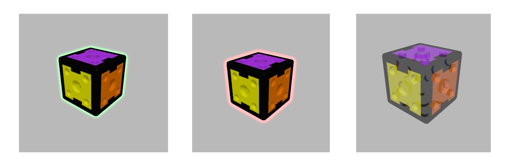

>LED Schaltplan
# Feedback and Visualisation
## Overview
The learning application visualises both the selected target construction and the current detected construction as interactive 3D models. The digital representation is supplemented by feedback provided on two levels:

- **digital feedback** in the browser-based learning application
- **local feedback** directly on the physical bricks

The frontend uses Three.js to render the brick models and allows the construction to be rotated and zoomed for inspection from different perspectives.

## Target and Current Construction Visualisation
Before starting a task, the learner selects a target structure from the available constructions. The selected target can be inspected in a three-dimensional preview.

During the construction session, the detected brick structure is reconstructed digitally and displayed in the frontend. The spatial pose of each brick is calculated from its type, connection to the parent and relative orientation.

The current construction is updated whenever a new detected structure is received from the backend.

## Feedback States
The backend compares the detected construction with the selected target and assigns an evaluation state to each relevant position.

| State | Frontend Representation | Physical Feedback |
|---|---|---|
| `CORRECT` | Green pulsing outline | Green LED |
| `WRONG` | Red pulsing outline | Red LED |
| `UNEXPECTED` | Red pulsing outline | Red LED |
| `ATTACHABLE` | Semi-transparent ghost brick | None |
| `BLOCKED` | Not displayed | None |

Digital brick feedback: correct (left), wrong or unexptected (center) and attachable (right):

Local feedback is addressed using the individual brick identifier and returned through the baseplate to the connected brick structure (see [Communication Protocol](docs/communication-protocol.md)).

A progress bar additionally indicates the proportion of the target structure that has already been completed correctly.