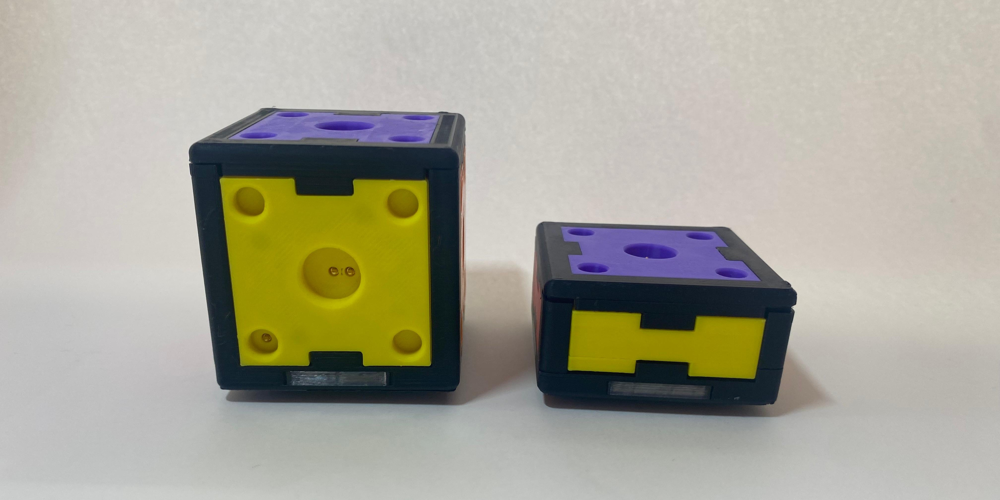
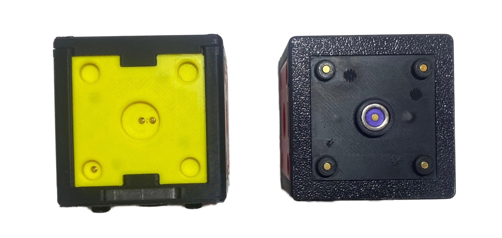
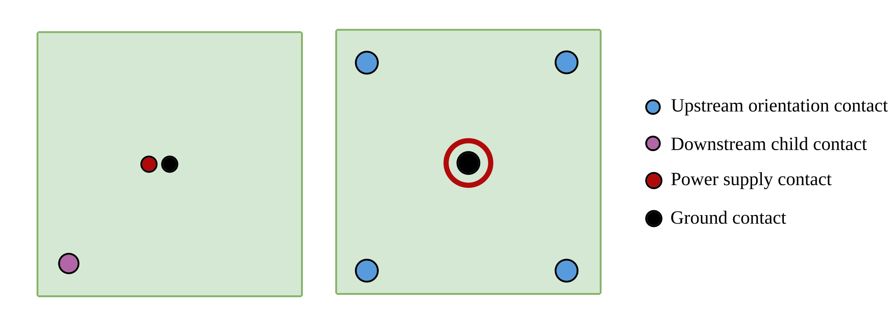
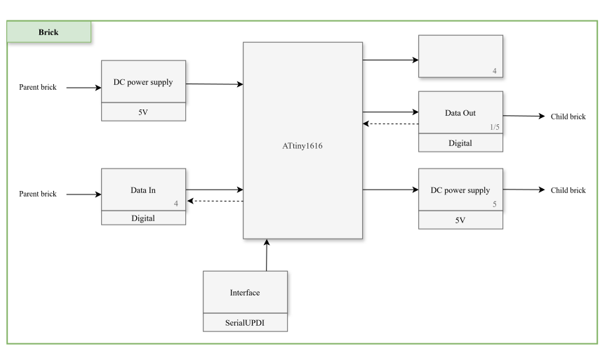
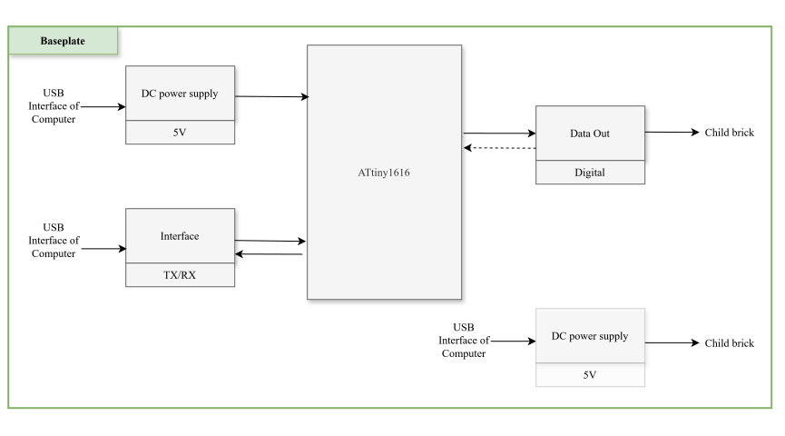

>**TODO**: Design and Manufacturing Files, Schaltplan LED, docking face separat, verbinder erklärung und link, vlt anders anorden alles

# Hardware
## Overview
The physical prototype consists of two types of active bricks and a central baseplate. The components combine a modular 3D-printed housing, magnetic and form-fit connections, electrical contacts and electronics with an ATtiny1616.

The building bricks are supplied centrally through the baseplate and therefore do not require individual batteries.

For the overall system structure, see [System Architecture](docs/architecture.md).
For the communication between the electronic components, see [Communication Protocol](docs/communication-protocol.md).

## Brick Design
### Brick Types
Two brick geometries were implemented:

| Brick Type | Geometry | Connection Faces |
|---|---|---|
| Cube brick | Approx. 40 mm × 40 mm × 40 mm | One docking face and five receiving faces |
| Smashed brick | Half-height brick | One docking face and one opposing receiving face |

Brick types: cube brick (left) and smashed brick (right)

Each brick type has two different connection face types die beide aber eine quadratische grundfläche besitzen:
#### Docking face
The docking face connects a brick to the existing construction. Each brick has just one of it. 

#### Receiving face
The receiving face allow additional bricks to be attached through their respective docking face at a brick. The amount of this face in a brick depends on its type. 

Interface types: Receiving face (left) and docking face (right)

Consequently, a valid connection can only be established between a receiving face of the parent brick and the docking face of the child brick.

The cube brick supports linear and branching three-dimensional constructions. The smashed brick supports connections along its local vertical axis.  
All connection faces use the same square interface geometry and allow four relative orientations in increments of 90°.

### Housing
The housings were designed in Autodesk Inventor and manufactured using 3D printing.  
Each brick uses a modular housing consisting of:

- a supporting frame containing the docking face (dockinf face separat)
- interchangeable side modules containing the receiving faces
- a removable cover 

This structure allows the electronic components and individual side modules to be assembled, accessed and replaced separately.  
The design and manufacturing files are listed at the end of this document.

## Connection
A valid connection is established between the receiving face of a parent brick and the docking face of a child brick.

### Mechanical Connection
The mechanical connection uses complementary guiding structures and magnets. Recessed elements on the docking face fit into corresponding protruding elements on the receiving face and align the two interfaces. Magnets assist the alignment and hold the connected bricks together. This recessed interface geometry protects the contacts and reduces the risk of incorrect contacting.  
The square interface geometry permits four valid relative orientations in increments of 90°.

### Connection Possibilities
The bricks can therefore be connected through different receiving faces and can additionally be rotated relative to each other in increments of 90°. This enables linear, angled and branching three-dimensional constructions.

### Electrical Connection
The same connection also provides Spring-loaded pogo pin contacts for `5 V`, ground and data. Each receiving face provides a single downstream child contact for communication, while the docking face contains four upstream orientation contacts corresponding to rotations around the connection axis in 90° increments. 
Power and ground contacts are arranged rotationally symmetrically so that they remain connected in all four orientations.

On one receiving face of the cube brick, the data contact is offset by one corner due to space constraints; this orientation offset is corrected in the firmware.

Contact arrangement on receiving face (left) and docking face (right):

## Orientation Detection
Relative orientation is detected through the electrical contact
arrangement of the connection. Depending on the rotational alignment of  two bricks, one of the four orientation contacts of the docking face connects to the communication contact of the parent’s receiving face. By detecting which orientation contact is active, the child brick determines its orientation relative to the parent. The same established signal path is subsequently used for data communication with the parent

## Brick Electronics
Each active brick is controlled by an ATtiny1616 microcontroller.  
The main brick electronics include:

- ATtiny1616 microcontroller
- PCB
- four data in/ upstream orientation contacts (docking face)
- one or five data out/communication/downstream contacts (receiving face(s))
- power distribution
- four side-view RGB LEDs

The ATtiny1616 and the components of the docking interface are mounted on a custom PCB designed using KiCad.  
The receiving-face contacts are connected to the main PCB through internal wiring.

Blockdiagram of a brick:

PCB layout and the schematic are listed at the end of this document. 

### contacts
- docking face:
    - upstream: 4 female pogo pins mounted on pcb
    - ground: 1 female pogo pin mounted on  pcb
    - vcc: combination of smd pogo pin on pcb and neodym ring (pogo pin kontaktiert neodym ring)
- downstream face:
    - downstream: 1 solder cup pogo pin
    - ground: 1 solder cup pogo pin
    - vcc: 1 solder cup pogo pin
    -> über kabel und stecker an pcb befestigt

#### Local Feedback Hardware
The four side-view RGB LEDs provide local visual feedback directly on the affected physical brick. The implemented application uses green and red illumination.

>**ACHTUNG** im schaltplan sind sie falsch angeordnet deswegen aktuell nicht funktionstüchtig

Further information about the feedback is provided in[Feedback and Visualization](docs/feedback.md).

### Pin Assignment?
>**TODO**: check correctness
| Pin | Function | Description |
|-----|----------|-------------|
| PA1 | Upstream orientation 0 | Parent communication line for orientation 0 |
| PA3 | Upstream orientation 1 | Parent communication line for orientation 1 |
| PA4 | Upstream orientation 2 | Parent communication line for orientation 2 |
| PA5 | Upstream orientation 3 | Parent communication line for orientation 3 |
| PB0 | Downstream child port 0 | Data line to child port 0 |
| PB1 | Downstream child port 1 | Data line to child port 1 |
| PB4 | Debug LED | Status/debug output |

### Electrical Principle?
 All lines are single-wire, open-drain-emulated UART/NRZ by switching each pin between output-low and input-with-pullup. The communication is half duplex, meaning that only one device may transmit at a time.

The line has two logical states:

- HIGH = idle / released
- LOW  = actively pulled low

The line is therefore not actively driven high. Instead, similar to an open drain interface, the microcontroller releases the line and a pull-up resistor brings it to the high state.

#### Open Drain like Operation?
The open-drain-like behavior is implemented by switching the GPIO mode:

Transmit LOW:
    GPIO configured as output
    output level = LOW

Transmit / idle HIGH:
    GPIO configured as input
    pull-up enabled

This approach reduces the risk of electrical conflicts, because no device actively drives the line high.

---
## Baseplate Design and Electronics
The baseplate forms the physical starting point of every construction. Because it is the root, it has no docking interface. Right now, only one brick can connect to the baseplate, it therefore has just one receiving face. 

It contains:
- an ATtiny1616 microcontroller
- one data out/communication/downstream contact (receiving face)
- the connection to the host computer
- the central power input

Blockdiagram of the baseplate:

The baseplate communicates with the host computer using its hardware USART and a USB-to-TTL UART adapter.

## Power Supply
The complete brick structure is supplied centrally with 5 V DC through the baseplate. Power is forwarded through every connected brick. The building bricks therefore contain no individual batteries or rechargeable cells.

In the implemented prototype, the 5 V supply is provided from the host computer through the USB-to-TTL UART adapter.

## Design and Manufacturing Files
>**TODO**: erstellen und files hochladen
The repository contains the files required to document and reproduce the developed hardware.

| Content | Repository Location |
|---|---|
| Brick CAD files | `[PATH]` |
| Baseplate CAD files | `[PATH]` |
| Printable models? | `[PATH]` |
| KiCad project | `[PATH]` |
| Circuit schematic | `[PATH]` |
| PCB layout | `[PATH]` |
| Gerber files? | `[PATH]` |
| Bill of materials? | `[PATH]` |
| Additional manufacturing files | `[PATH]` |

## Prototype Status
Eight physical prototype bricks were manufactured. The mechanical interaction and handling of the bricks were evaluated with the intended target group, while the integrated electronic construction-detection system was not sufficiently reliable for a complete end-to-end evaluation.  
No standardised durability or product-safety certification was conducted.

