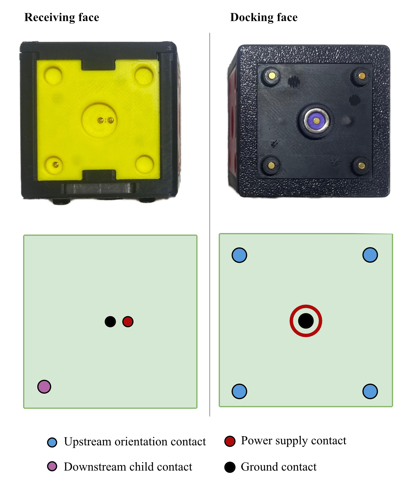
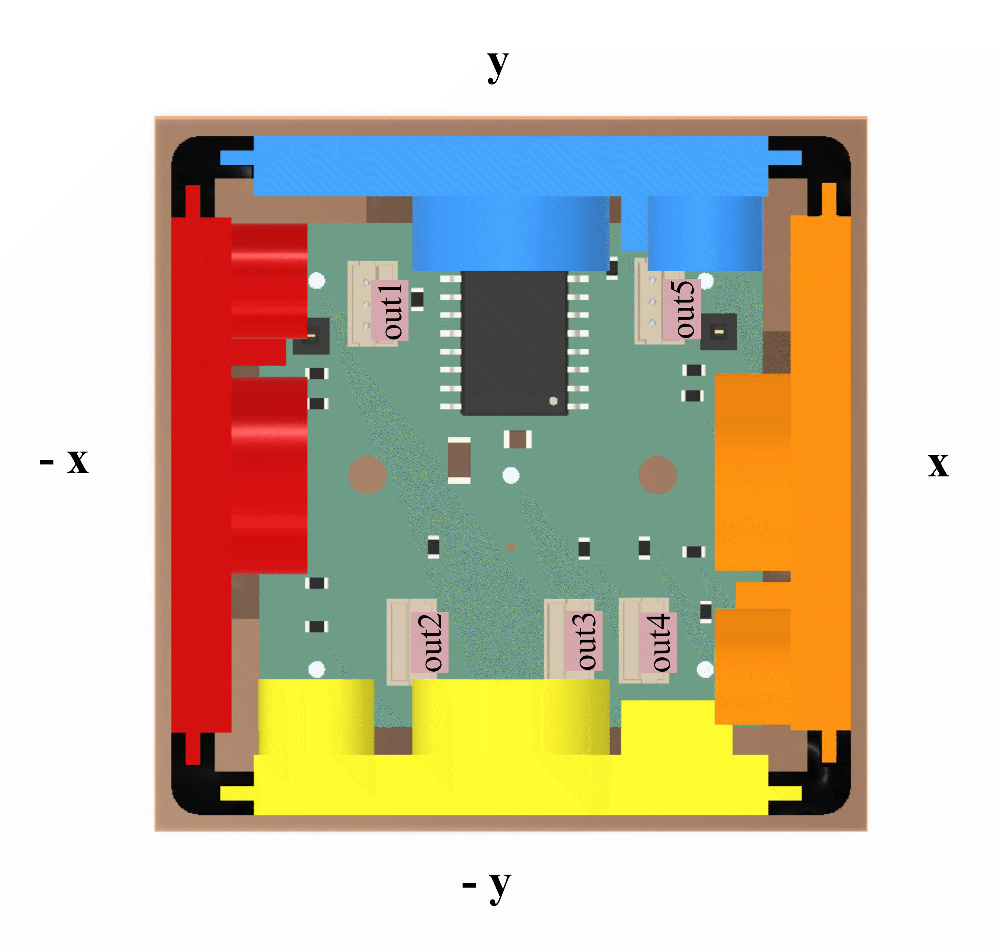

>**TODO**:  3d modell mit allem integrierten, sagen baseplate kein pcb angefertigt

# Hardware
## Overview
The physical prototype consists of two types of active bricks and a central baseplate. The components combine a modular 3D-printed housing, magnetic and form-fit connections, electrical contacts and electronics with an ATtiny1616. The building bricks are supplied centrally through the baseplate and therefore do not require individual batteries.

For the overall system structure, see [System Architecture](docs/architecture.md).
For the communication between the electronic components, see [Communication Protocol](docs/communication-protocol.md).

## Brick Design
### Brick Types
Two brick geometries were implemented:

| Brick Type | Geometry | Connection Faces |
|---|---|---|
| Cube brick | Approx. 40 mm × 40 mm × 40 mm | One docking face and five receiving faces |
| Smashed brick | Half-height brick | One docking face and one receiving face |

 Brick types: cube brick (left) and smashed brick (right)

### Connection Faces
Each brick type has two different connection face types:
#### Docking face
The docking face connects a brick to the existing construction. Each brick has just one of it. 

#### Receiving face
The receiving face allow additional bricks to be attached through their respective docking face at a brick. The amount of this face in a brick depends on its type.

>BILD 3D brick mit pfeilen docking und receiving face oder sogar zwei verbunden

Consequently, a valid connection can only be established between a receiving face of the parent brick and the docking face of the child brick. The cube brick supports linear and branching three-dimensional constructions. The smashed brick supports connections along its local vertical axis.  
All connection faces use the same square interface geometry and allow four relative orientations in increments of 90°.

### Housing and 3D printed parts 
The housings were designed in Autodesk Inventor and manufactured using 3D printing.  
Each brick uses a modular housing consisting of:

- a supporting frame with transparent parts for the LED light
- a docking face (glued into the frame) and a magnet holder for its vcc contact construction (see [contacts](#contacts))
- interchangeable side modules containing the receiving faces
- a removable cover 

This structure allows the electronic components and individual side modules to be assembled, accessed and replaced separately.  

The design and manufacturing files are listed at the end of this document.

>BILD auseinandergebaut

## Connection
A valid connection is established between the receiving face of a parent brick and the docking face of a child brick.

### Mechanical Connection
The mechanical connection uses complementary guiding structures and magnets. Recessed elements on the docking face fit into corresponding protruding elements on the receiving face and align the two interfaces. Magnets assist the alignment and hold the connected bricks together. This recessed interface geometry protects the contacts and reduces the risk of incorrect contacting.  
The square interface geometry permits four valid relative orientations in increments of 90°.
The bricks can therefore be connected through different receiving faces and can additionally be rotated relative to each other. This enables linear, angled and branching three-dimensional constructions.

### Electrical Connection
The same connection also provides Spring-loaded pogo pin contacts for `5 V`, ground and data. Each receiving face provides a single downstream child contact for communication, while the docking face contains four upstream orientation contacts corresponding to rotations around the connection axis in 90° increments. 
Power and ground contacts are arranged rotationally symmetrically so that they remain connected in all four orientations.

On one receiving face of the cube brick (Out2), the data contact is offset by one corner due to space constraints; this orientation offset is corrected in the firmware.

 Connection face types and electrical contact arrangement

## Orientation Detection
Relative orientation is detected through the electrical contact arrangement of the connection. Depending on the rotational alignment of  two bricks, one of the four orientation contacts of the docking face connects to the downstream child contact of the parent’s receiving face. By detecting which orientation contact is active, the child brick determines its orientation relative to the parent. The same established signal path is subsequently used for data communication with the parent

## Brick Electronics
Each active brick is controlled by an ATtiny1616 microcontroller. The main brick electronics include:

- ATtiny1616 microcontroller
- PCB
- four - data in - upstream orientation contacts (docking face)
- one or five - data out - downstream child contacts (receiving face(s))
- power distribution
- four side-view RGB LEDs

The ATtiny1616 and the components of the docking interface are mounted on a custom PCB designed using KiCad. The receiving-face contacts are connected to the main PCB through internal wiring.

 Blockdiagram of a brick

PCB layout and the schematic are listed at the end of this document. 

### electric contact interfaces
- docking face:
    - **upstream orientation contacts**: 4 female pogo pins mounted on pcb
    - **ground**: 1 female pogo pin mounted on pcb
    - **vcc**: combination of smd pogo pin on pcb and neodym ring - washer construction -> the smd pogo pin contacts the washer which contacts the neodym ring and the neodym ring is contacted by the vcc contact of the downstream face
- downstream face:
    - **downstream child contact**: 1 solder cup pogo pin
    - **ground**: 1 solder cup pogo pin
    - **vcc**: 1 solder cup pogo pin
    -> über kabel und stecker an pcb befestigt

### Electrical Principle
All communication lines are single-wire, half-duplex and open-drain-emulated: only one device may transmit at a time, and no device ever actively drives the line high. Each pin toggles between two GPIO modes to produce the line's two logical states:

| Logical state | GPIO mode | Effect |
|---|---|---|
| **LOW** (actively driven) | output, level LOW | pin pulls the line low |
| **HIGH** (idle / released) | input, pull-up enabled | pin releases the line; a pull-up resistor restores the high level |

Because HIGH is never driven, only released, this behaves like a classic open-drain bus and avoids electrical conflicts between devices sharing the line.

### Local Feedback Hardware
The four side-view RGB LEDs provide local visual feedback directly on the affected physical brick. The implemented application uses green and red illumination.  
Further information about the feedback is provided in[Feedback and Visualization](docs/feedback.md).

## Baseplate Design and Electronics
The baseplate forms the physical starting point of every construction. Because it is the root, it has no docking interface. Right now, only one brick can connect to the baseplate, it therefore has just one receiving face. It contains:
- an ATtiny1616 microcontroller
- one - data out - downstream child contact (receiving face)
- the connection to the host computer
- the central power input

The baseplate communicates with the host computer using its hardware USART and the unmodified USB-to-TTL UART adapter.

 Blockdiagram of the baseplate

PCB layout and the schematic are listed at the end of this document.

### Power Supply
The complete brick structure is supplied centrally with 5V DC through the baseplate. Power is forwarded through every connected brick. The building bricks therefore contain no individual batteries or rechargeable cells.

In the implemented prototype, the 5V supply is provided from the host computer through the USB-to-TTL UART adapter.

## Pin Assignment
Derived from `firmware/src/lib/cube_hardware.cpp` and `firmware/include/cube_identity.h`. Covers both brick types and the baseplate.

**Upstream orientation ports** - identical for every non-baseplate brick type, one per docking-face orientation contact:

| Pin | Bitmask | Orientation Index | Rotation |
|---|---|---|---|
| PA1 | `PIN1_bm` | 0 | 0 degree |
| PA2 | `PIN2_bm` | 1 | 90 degree |
| PA6 | `PIN6_bm` | 2 | 180 degree |
| PA7 | `PIN7_bm` | 3 | 270 degree |

The baseplate has no upstream ports - it is the tree root and has no docking face.

**Downstream child ports** - one receiving-face contact per port, set differs by brick type:

| Brick Type | Port | Pin | Face Direction | Wire Color | Notes |
|---|---|---|---|---|---|
| Normal | Out1 | PC3 | -x | red | |
| Normal | Out2 | PA3 | -y | yellow | data contact offset by one corner due to space constraints; compensated in firmware ([detection.cpp](../firmware/src/lib/detection.cpp)) |
| Normal | Out3 | PA4 | +z | purple | |
| Normal | Out4 | PA5 | +x | orange | |
| Normal | Out5 | PB1 | +y | blue | |
| Smashed | Out1 | PC3 | +z | purple | |
| Baseplate | (only port) | PB1 | +z | purple | |

 Ports and Face Direction

**Feedback LED** (from `config.h`):

| Pin | Function |
|---|---|
| PB5 | rgb LED |

## Design and Manufacturing Files
>**TODO**: erstellen und files hochladen
The repository contains the files required to document and reproduce the developed hardware.

| Content | Repository Location |
|---|---|
| CAD files | [hardware/CAD_files](../hardware/CAD_files) |
| PCB files and schematics| [hardware/pcb_files](.../hardware/pcb_files) |
| Bill of materials brick | [hardware/pcb_files/brick](.../hardware\pcb_files\brick\14-09-26_brick_BOM_total.xlsx) |
| Bill of materials baseplate | [hardware/pcb_files/baseplate](.../hardware\pcb_files\baseplate\14-09-26_baseplate_BOM_total.xlsx) |

# Prototype Status
Eight physical prototype bricks were manufactured. No standardised durability or product-safety certification was conducted.

