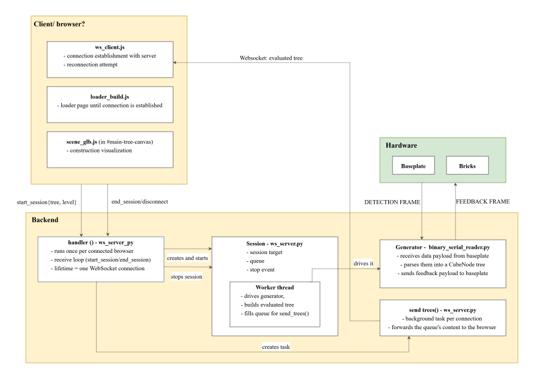

# Software
This directory contains everything that runs on the PC side of the learning application, as opposed to the embedded firmware in [firmware/](..firmware/). 

## Directory structure
```text
software/
├── threejs_visualization/     # the learning application
    ├── backend/               # Python: serial link to the baseplate, comparison, WebSocket server
    └── frontend/              # three.js: target selection, 3D visualization, feedback
```

## threejs_visualization
The actual learning application: a Python backend and a browser-based three.js frontend, connected over a WebSocket.

- **backend/**:
   - reconstructs the detected construction from the baseplate's serial frames
   -  compares it against the selected target
   - sends feedback to both the baseplate (LEDs) and the frontend (3D view).
  See [backend/README.md](threejs_visualization/backend/README.md) for more infos (the
  file layout, (data flow), and how to run it.)
- **frontend/** 
   - manages the target selection
   - creates the 3D visualization of the target and detected construction based on the feedback from the backend
   - provides digital feedback through the visualization
   See [frontend/README.md](threejs_visualization/frontend/README.md) for more infos 

## System overview
One build session, from the browser clicking "start" to a detected cube
lighting up green in the 3D view, crosses three components: the browser
(frontend), the backend process and the physical baseplate/bricks.

`handler()` receives `start_session` from the browser and creates the
`Session`, whose `Worker thread` drives the `Generator` (`binary_serial_reader.py`) to talk to the baseplate over serial. Every evaluated tree the worker produces is handed to `send_trees()` through the session's queue, which forwards it to the browser over the WebSocket.

<center>

<p>Software system architecture</p>
</center>


